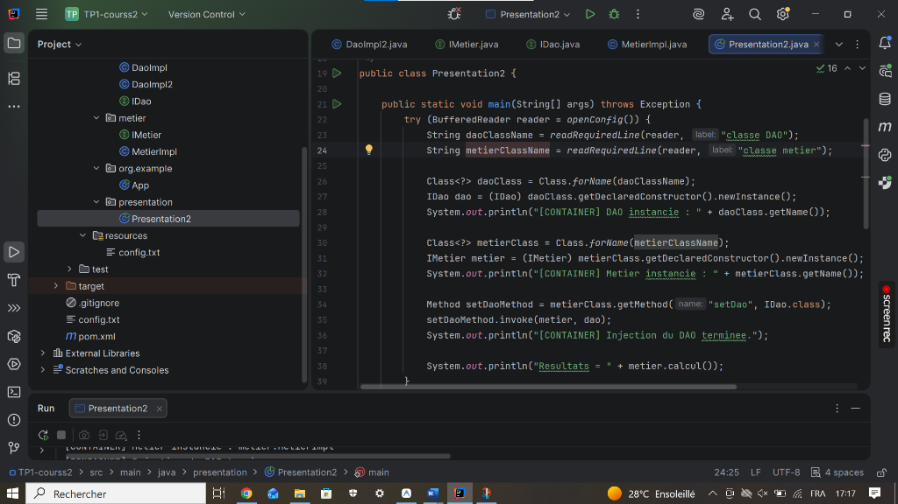
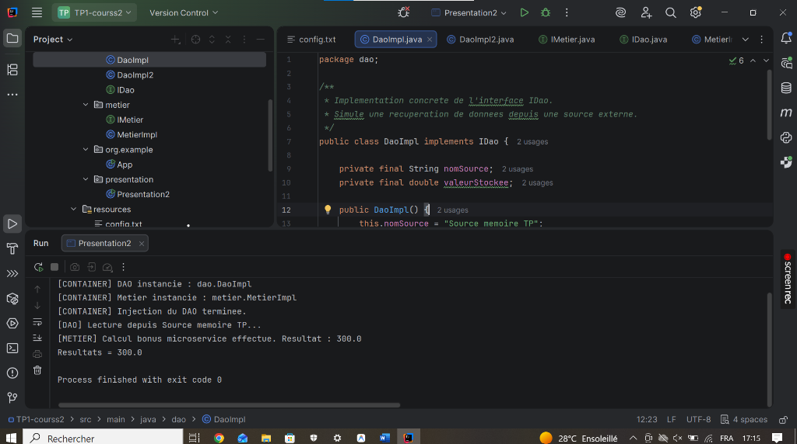

# TP 1 : Programmation dynamique par réflexion dans une architecture Microservices

**Auteur :** Moad Moussaoui  
**Cours :** Architecture Microservices : Conception, Déploiement et Orchestration  
**Dépôt GitHub :** [https://github.com/moadms/Tp1-cours2.git](https://github.com/moadms/Tp1-cours2.git)  

---

## 🎯 Objectifs du TP
Ce laboratoire pratique vise à maîtriser les concepts avancés de la **programmation dynamique en Java**, spécifiquement à travers l'**API de réflexion** (`java.lang.reflect`) dans le cadre d'une architecture orientée Microservices :
1. **Découplage et inversion de contrôle (IoC) :** Isoler la logique métier des détails d'implémentation de la couche d'accès aux données grâce aux interfaces (`IDao` et `IMetier`).
2. **Instanciation dynamique :** Charger et instancier des classes à l'exécution sans couplage fort à la compilation (`Class.forName()`, `getDeclaredConstructor().newInstance()`).
3. **Injection de dépendances par réflexion :** Invoquer dynamiquement les méthodes setter (`Method.invoke()`) pour lier les composants à partir d'un fichier externe de configuration (`config.txt`).
4. **Interchangeabilité à chaud :** Permettre le remplacement d'un composant (ex: basculer de `DaoImpl` vers `DaoImpl2`) sans modifier ni recompiler le code métier.

---

## 🏗️ Structure du Projet

```text
Tp1-cours2/
├── pom.xml
├── config.txt
├── README.md
├── docs/
│   └── images/
│       ├── 01-architecture-presentation2.png
│       └── 02-execution-console-resultat.png
└── src/
    └── main/
        ├── java/
        │   ├── dao/
        │   │   ├── IDao.java          # Contrat d'abstraction d'accès aux données
        │   │   ├── DaoImpl.java       # Implémentation principale (Source mémoire TP)
        │   │   └── DaoImpl2.java      # Seconde implémentation (Capteur IoT V2)
        │   ├── metier/
        │   │   ├── IMetier.java       # Contrat d'abstraction de la logique métier
        │   │   └── MetierImpl.java    # Logique métier avec dépendance injectable IDao
        │   ├── org/example/
        │   │   └── App.java           # Point d'entrée standard
        │   └── presentation/
        │       └── Presentation2.java # Moteur IoC de chargement dynamique par réflexion
        └── resources/
            └── config.txt             # Configuration externe des classes
```

---

## ⚙️ Configuration Dynamique (`config.txt`)

Le conteneur lit les noms fully-qualified des classes depuis `config.txt` :
```text
dao.DaoImpl
metier.MetierImpl
```

Pour basculer dynamiquement vers la source de données IoT sans recompiler le projet :
```text
dao.DaoImpl2
metier.MetierImpl
```

---

## 📸 Preuves d'Exécution & Captures d'Écran

### 1. Implémentation du conteneur IoC dynamique (`Presentation2.java`)
L'orchestrateur lit la configuration, instancie les composants par réflexion et réalise l'injection du DAO dans la couche métier.



---

### 2. Exécution et Validation Console (Résultat = 300.0)
Exécution réussie démontrant le cycle complet : chargement dynamique, instanciation, injection et exécution du calcul métier.



---

## 🚀 Compilation et Exécution

### Via Ligne de Commande :
```bash
# Compilation des sources
javac -d target/classes src/main/java/dao/*.java src/main/java/metier/*.java src/main/java/org/example/*.java src/main/java/presentation/*.java

# Copie des ressources
cp src/main/resources/config.txt target/classes/

# Exécution du conteneur dynamique
java -cp target/classes presentation.Presentation2
```

### Trace d'exécution obtenue :
```text
[CONTAINER] DAO instancie : dao.DaoImpl
[CONTAINER] Metier instancie : metier.MetierImpl
[CONTAINER] Injection du DAO terminee.
[DAO] Lecture depuis Source memoire TP...
[METIER] Calcul bonus microservice effectue. Resultat : 300.0
Resultats = 300.0

Process finished with exit code 0
```